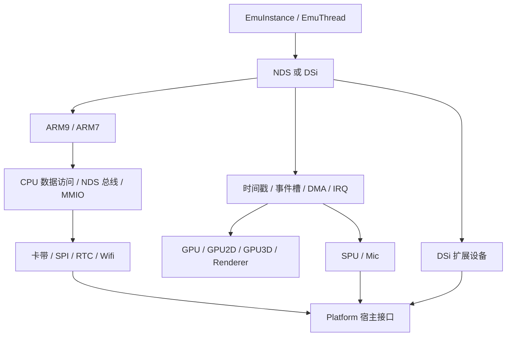

# 整体架构、状态和执行主链

[返回总路由](README.md)。本章适用于建立系统骨架、修改调度、移植宿主或判断跨模块影响。

## 源码入口

| 源码 | 首读符号 | 作用 |
|---|---|---|
| [NDS.h](../src/NDS.h)、[NDS.cpp](../src/NDS.cpp) | `NDS`、`Reset`、`RunFrame`、`NextTarget`、`RunSystem` | 整机状态与系统时间 |
| [Args.h](../src/Args.h) | `NDSArgs`、`DSiArgs` | 创建实例需要的资源和可选设置 |
| [DSi.h](../src/DSi.h) | `DSi final : public NDS` | 复用 DS 并覆写扩展总线行为 |
| [Platform.h](../src/Platform.h) | `UserData` 对应的回调参数 | 核心向宿主请求文件、线程、声音输入与网络 |
| [EmuThread.cpp](../src/frontend/qt_sdl/EmuThread.cpp) | `run`、`handleMessages` | 宿主循环、消息队列与帧节流 |

## 组件和所有权



`NDS` 持有 CPU、八个传统 DMA 通道、GPU、SPU、Mic、SPI、RTC、Wifi、卡槽、作弊引擎与 JIT 等组件；这些组件通过对整机的引用请求总线、IRQ 和调度。不是每个组件都是独立宿主线程。`DSi` 在同一调度框架中增加新 WRAM、第二卡槽、SDMMC、SDIO、NDMA、AES、DSP、摄像头与 I²C/I²S。

RAM 分配有一个容易误判的入口：`NDS::MainRAM`、共享 WRAM、ARM7 WRAM、DSi NWRAM 的底层存储由 `ARMJIT_Memory` 提供，即使关闭 JIT 也有非 JIT 存储分支。新实现可以直接让整机持有这些数组；需要保留的是物理内存唯一性与别名映射，不是必须复制这个类名。

`UserData` 把一个核心实例对应到一个前端实例。`NDS::Current` 是线程局部指针；JIT 的故障处理、网络接口单例等宿主设施也存在，不能仅看到实例类就推断所有调用都能任意并发。

## 时间单位与调度

系统时间采用与 ARM7 一致的周期单位。`ARM7Timestamp` 和 `SysTimestamp` 使用此单位；`ARM9Timestamp`、`ARM9Target` 使用 ARM9 时钟单位。换算为 `arm9_time >> ARM9ClockShift`。DS 的 shift 为 1，DSi 可为 1 或 2，切频要同时转换当前时间与执行目标。

`SchedList[Event_MAX]` 是固定事件槽表，每种事件同时最多一个待执行项；每槽保存 `Timestamp`、`FuncID`、`Param`，回调与 `That` 由设备构造时注册。`MaxEventFunctions = 3` 让一个事件槽可以有多个阶段函数。它不是支持任意相同事件入队的通用优先队列。

`ScheduleEvent(id, periodic, delay, funcid, param)` 的两个基准不同：

- 周期事件：在该槽上一次时间戳上加 delay，避免调用晚到导致长期漂移。
- 非周期事件：取当前正在执行 CPU 的系统时间加 delay。

调度同时调用 `Reschedule` 缩短当前 CPU 目标。已有待执行事件时，当前实现记录日志并拒绝重复调度；重新安排通常先取消。`RunSystem` 先清待执行位，再调用设备，使回调能安排下一次事件；一次扫描按事件编号遍历，因此相同时间的顺序也属于对照行为。

## 一帧的实际执行顺序

下面是阅读用伪代码，名称对应 `NDS::RunFrame<CPUExecuteMode>`，不是可直接编译的 API：

```text
记录帧起始时间，清本帧扫描线计数
若未处于睡眠唤醒续跑，GPU.StartFrame()
循环到 GPU.FinishFrame() 写入 TotalScanlines：
    target = NextTarget()
    ARM9Target = target << ARM9ClockShift
    按 GX stall / DMA9(+NDMA9) / CPU9 的优先分支推进 ARM9
    RunTimers(0)，GPU3D.Run()
    target = ARM9Timestamp >> ARM9ClockShift
    反复推进 DMA7(+NDMA7) 或 CPU7 直到 ARM7 追上 target
    每次 ARM7 批次后 RunTimers(1)
    RunSystem(target) 执行到期事件
SPU.BufferAudio()，更新帧数和 lag 帧数，返回实际扫描线数
```

`NextTarget` 在最近事件和 `SysTimestamp + 64` 之间选目标，另有 8 周期余量规则。CPU 指令可能越过目标；随后 ARM7 与设备追赶的是 ARM9 实际到达的时间。把两 CPU 各执行固定条数、或先跑完整 ARM9 帧再跑 ARM7，会破坏 IPC、DMA 和无线同步。

`RunFrame()` 根据编译选项与运行配置选择 JIT、带 GDB 的解释器或普通解释器。性能路径都必须维持上述可观察顺序。

## 停止、暂停、睡眠、阻塞

| 状态 | 控制位置 | 时间是否推进 |
|---|---|---|
| UI 暂停 | `EmuThread` 的暂停栈和状态 | 宿主不再请求正常帧 |
| 整机停止 | `NDS::Stop`、`Running` | 核心停止运行，并通知前端 |
| CPU HALT | `ARM::Halted`、`HaltInterrupted` | 设备继续，CPU 等中断 |
| DMA 占用 CPU | `CPUStop_DMA9/7`、`StopCPU` | DMA 取代对应 CPU 执行并计时 |
| GX FIFO 满 | `CPUStop_GXStall` | ARM9 等待几何引擎消耗 FIFO |
| 合盖睡眠 | `CPUStop_Sleep`、`RunSystemSleep` | 走专用睡眠调度，RTC 继续 |

睡眠路径不是一般“全设备暂停”：`NextTargetSleep` 关注 SPU/RTC 的时间点，`RunSystemSleep` 只实际运行 RTC 回调，并延后其他到期事件；`RunFrame` 保持帧交付节奏。注释中音频同步的意图与各实现细节要一起读，不能推导睡眠时仍正常混音。唤醒通过 ARM7 IRQ 路径恢复，并处理 3D 帧重启。

## 跨模块变更表

| 改变的行为 | 必须追踪到的消费者 |
|---|---|
| CPU 数据读写 | MMIO 副作用、CP15 权限/时序、DMA 使用的总线入口、JIT 快慢路径 |
| WRAM/VRAM/TCM 映射 | CPU 取指缓存、JIT 地址归一化/失效、渲染脏块、存档恢复 |
| 事件时间/时钟倍率 | 两 CPU target、Timer、GPU3D、SPU、无线、DSi DSP |
| IRQ 标志 | `IE/IF/IME`、CPU IRQ 输入、HALT 唤醒、睡眠唤醒、清除后重触发 |
| 新设备状态 | Reset、MMIO、调度、DMA、IRQ、DoSavestate、前端资源生命周期 |
| 视频捕获 | Renderer 回写、CPU/DMA 读 VRAM、纹理读取、存档前同步 |
| 外部存储写入 | 核心镜像、宿主保存回调、线程缓冲、快照与磁盘版本关系 |

## 复刻检查

用固定输入驱动两台独立实例，逐次记录 `(system_time, cpu, PC, event_id)`；观察相同时间事件顺序、DMA 中断点和 HALT 唤醒是否一致。存档恢复后继续执行同一段输入，必须恢复事件剩余时间，不能重新从设备默认周期开始。完整验收输入与证据要求见 [验证方案](validation.md)。
